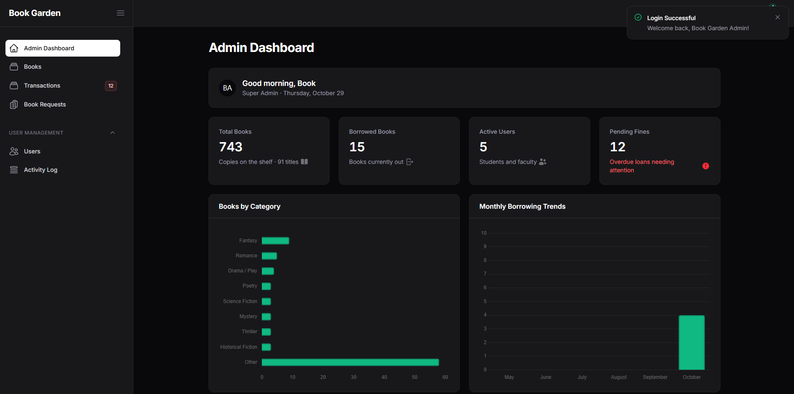
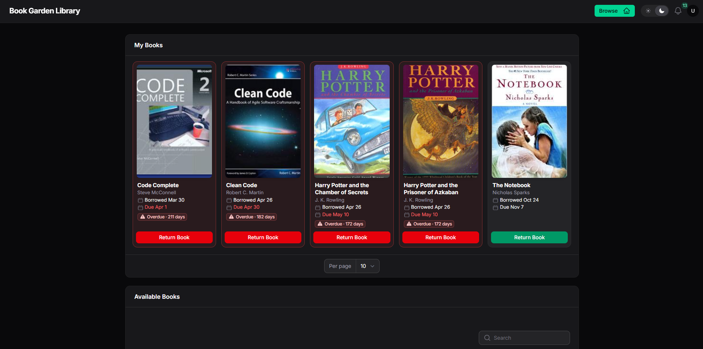
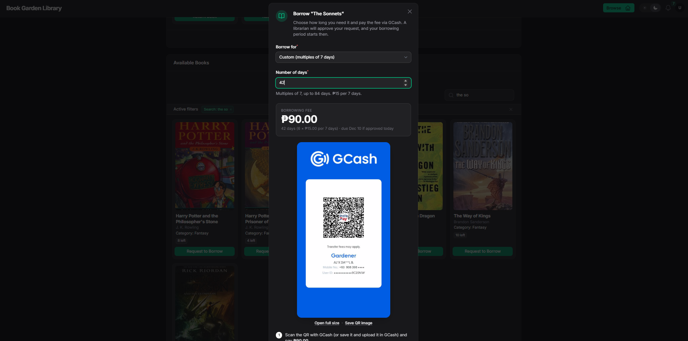
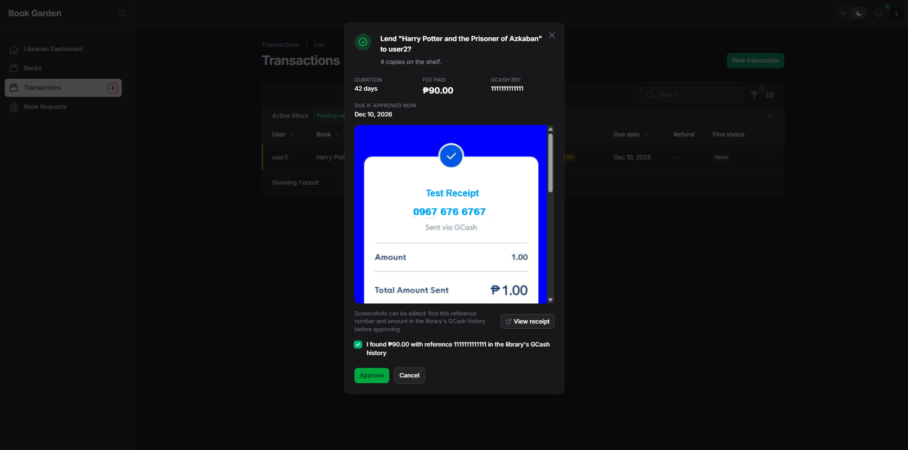

# Book Garden Online Library Management System

Book Garden is a library management system for a school or university library. Students and faculty browse the catalog, request books, and pay borrowing fees and overdue fines through GCash. Librarians approve requests, verify payments, check returned books back in, and process refunds. Every change is recorded in an audit log.

The interface is built on Filament with a clean, minimal look and Emerald green accents, in light and dark mode.

## Screenshots

<table>
  <tr>
    <td width="50%" valign="top">
      <a href="docs/images/admin-dashboard.png"></a>
      <p align="center"><strong>Admin Dashboard</strong><br><sub>Live stats, charts and shortcuts to pending work, in a clean layout with Emerald accents</sub></p>
    </td>
    <td width="50%" valign="top">
      <a href="docs/images/student-dashboard.png"></a>
      <p align="center"><strong>Student Dashboard</strong><br><sub>Active loans with due-date indicators, and the catalog of available books</sub></p>
    </td>
  </tr>
  <tr>
    <td width="50%" valign="top">
      <a href="docs/images/borrow-payment-flow.png"></a>
      <p align="center"><strong>Borrowing and Payment</strong><br><sub>Preset and custom durations, the calculated fee, the GCash QR code and receipt upload</sub></p>
    </td>
    <td width="50%" valign="top">
      <a href="docs/images/transactions-approvals.png"></a>
      <p align="center"><strong>Transactions and Approvals</strong><br><sub>Payment, refund and receipt verification from each row's actions menu</sub></p>
    </td>
  </tr>
</table>

## Core Features

### Students and Faculty (User Panel, `/user`)

- **Catalog:** browse and search available books, with covers and live stock counts.
- **Paid borrowing:** request a book for 7 days (₱15), 14 days (₱30), the 1 Month Promo (31 days for ₱60), or a custom length in multiples of 7 days up to 84 (₱15 per 7 days). The server always recalculates the fee from the chosen duration.
- **GCash payment:** scan the library's GCash QR code, enter the 13-digit reference number, and upload a screenshot of the receipt.
- **Borrowing rules:**
  - At most 3 books borrowed or requested at a time.
  - No new requests while any book is overdue.
  - No duplicate requests for the same book.
- **My Books:** loans and requests with due dates, plus "Due soon" and "Overdue" indicators.
- **Returns:** return a book on time, or pay the overdue fine (₱5 per day) through GCash. The book stays on your account until a librarian checks it in.
- **Cancel requests:** cancel a pending request. A confirmed payment is refunded through GCash.
- **Notifications:** in-app alerts for approvals, rejections, refunds, and books due within 3 days. Reminders arrive daily and at sign-in.
- **Profile:** borrowing history, refund status, a password change form, and sign-out.

### Librarians and Super Admins (Admin Panel, `/admin`)

- **Dashboard:** shortcuts to everything waiting on staff, plus live stats and charts for books by category and monthly borrowing.
- **Borrow requests:** approve or reject each request. Approving a paid request requires confirming the payment in the library's GCash history, not only the student's screenshot.
- **Payment checks:** when a paid request is cancelled or rejected, staff confirm the payment arrived before a refund is queued. A payment that never arrived is closed without a refund.
- **Refunds:** record each GCash refund with a screenshot as proof, and keep the screenshots for audits.
- **Fine verification:** accept or reject a student's fine receipt. Accepting it checks the book in.
- **Return verification:** confirm a returned book is physically back before it is restocked and removed from the student's limit.
- **Catalog and stock:** manage books, get low-stock alerts, and see which titles are popular.
- **Book requests:** librarians suggest new titles. Super admins approve them, which adds the book to the catalog as "On Order".
- **User management (super admins only):** manage accounts and roles, deactivate accounts, and view the full activity log.
- **Record protection:** users and books with borrowing history cannot be deleted. Deactivate the account, or set the stock to 0, instead.

### Security and Auditing

- **Rate-limited sign-in:** 5 failed attempts per minute per email and IP address, 20 per IP address across all emails, and 5 sign-ups per IP address per minute.
- **Deactivated accounts:** they cannot sign in or open either panel, even from an existing session.
- **Private receipts:**
  - Screenshots go to a private storage disk and are viewable only through signed links that expire after 15 minutes.
  - Uploads must be PNG, JPG, or WebP images up to 5 MB.
- **Activity log:** [Spatie Activitylog](https://spatie.be/docs/laravel-activitylog) records who changed which loan, book, or book request, field by field. A daily job deletes entries older than 365 days.
- **Race-condition safety:**
  - Requests, approvals, returns, and refunds run in database transactions with row locks, so two librarians cannot lend the last copy twice.
  - One GCash reference number cannot back two requests.
- **Controlled status changes:** a loan's status only changes through the workflow actions, never by editing the record directly.

## Tech Stack

| Layer | Technology |
| --- | --- |
| Framework | Laravel 12 (PHP 8.2) |
| Admin and user panels | Filament 4 |
| Reactive UI | Livewire 3, Alpine.js |
| Styling | Tailwind CSS 4 (built with Vite) |
| Database | MySQL 8 |
| Audit trail | Spatie Laravel Activitylog |
| Testing | Pest |

## Local Installation (Windows + XAMPP)

### Requirements

- XAMPP with **PHP 8.2** and MySQL (or a standalone MySQL 8 server)
- [Composer](https://getcomposer.org/)
- [Node.js](https://nodejs.org/) 20 or newer, with npm
- Git

Make sure `php -v` reports 8.2 in a new terminal, and that `C:\xampp\php` is on your `PATH`. In `C:\xampp\php\php.ini`, enable the `fileinfo`, `gd`, `intl`, `mbstring`, `openssl`, `pdo_mysql`, and `zip` extensions by removing the leading `;`.

### 1. Clone the repository

```bash
git clone https://github.com/Dan-sama1/OLMS-LARAVEL.git olms_bookgarden
cd olms_bookgarden
```

### 2. Install dependencies

```bash
composer install
npm install
```

### 3. Configure the environment

```bash
copy .env.example .env
php artisan key:generate
```

Open `.env` and check the database settings. The defaults match a fresh XAMPP install:

```env
APP_NAME="Book Garden Library"
APP_URL=http://127.0.0.1:8000
APP_TIMEZONE=Asia/Manila

DB_CONNECTION=mysql
DB_HOST=127.0.0.1
DB_PORT=3306
DB_DATABASE=olms_bookgarden
DB_USERNAME=root
DB_PASSWORD=
```

Use `127.0.0.1` rather than `localhost`. On Windows, `localhost` can add a noticeable delay to every database connection.

### 4. Create the database

Start **Apache** and **MySQL** in the XAMPP Control Panel. Then create an empty database named `olms_bookgarden` in phpMyAdmin (`http://localhost/phpmyadmin`), or run:

```bash
mysql -u root -e "CREATE DATABASE olms_bookgarden CHARACTER SET utf8mb4 COLLATE utf8mb4_unicode_ci;"
```

### 5. Run the migrations and create the first admin

```bash
php artisan migrate
php artisan db:seed
```

The seeder creates one super admin account:

| Email | Password |
| --- | --- |
| `admin@gmail.com` | `admin12345` |

Sign in and change this password immediately from your profile.

### 6. Link storage and build the front end

```bash
php artisan storage:link
npm run build
```

### 7. Start the application

```bash
php artisan serve
```

Open `http://127.0.0.1:8000`. Everyone signs in at `/login`: staff are sent to `/admin` and students to `/user`. New students create their own accounts from the **Register** tab.

### 8. Run the scheduler (optional for local use)

Daily due-date reminders and activity-log cleanup run on Laravel's scheduler. Keep this running in a second terminal during development:

```bash
php artisan schedule:work
```

On a server, add one cron entry (or a Windows Task Scheduler task) that runs `php artisan schedule:run` every minute.

### Running the tests

```bash
php artisan test
```

The test suite runs against an in-memory SQLite database, so it never touches your MySQL data.

## Payment Workflow

Book Garden uses a **manual GCash QR workflow** built for local Philippine deployments. No payment gateway is involved.

1. The student scans the library's GCash QR code (`public/images/gcash-qr.png`) and pays the amount shown.
2. The student enters the 13-digit GCash reference number and uploads a screenshot of the receipt.
3. A librarian finds that reference number and amount in the library's own GCash transaction history, then approves the request or accepts the fine.
4. If a paid request is cancelled or rejected, staff confirm the payment arrived, send the refund through GCash, and upload a screenshot of the refund as proof.

Replace `public/images/gcash-qr.png` with your library's own GCash QR code before going live. Screenshots can be edited, so staff should always confirm payments against the GCash account itself.

## Deploying to Production

Before deploying, update `.env`:

```env
APP_ENV=production
APP_DEBUG=false
APP_URL=https://your-domain.example
SESSION_ENCRYPT=true
SESSION_SECURE_COOKIE=true
```

Then run:

```bash
composer install --no-dev --optimize-autoloader
npm run build
php artisan migrate --force
php artisan optimize
```

Never upload database dumps or a filled-in `.env` file to the server or the repository.
